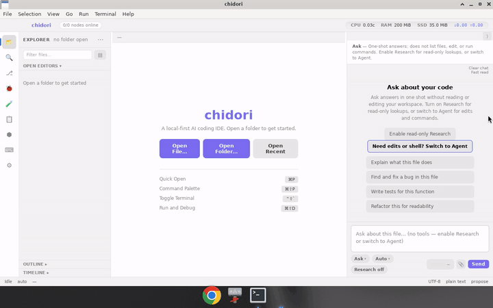
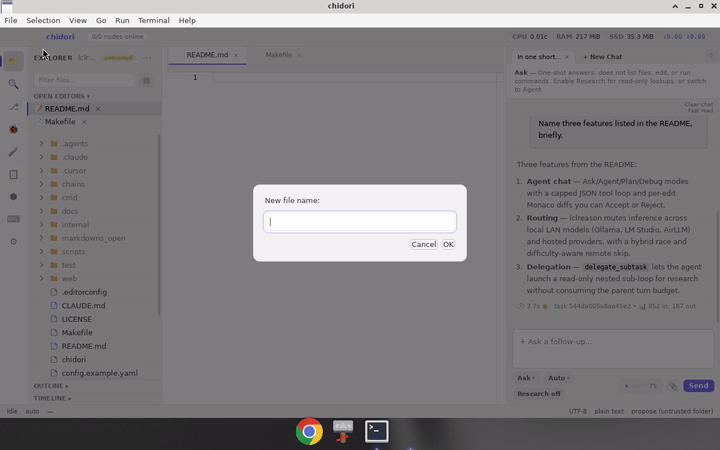
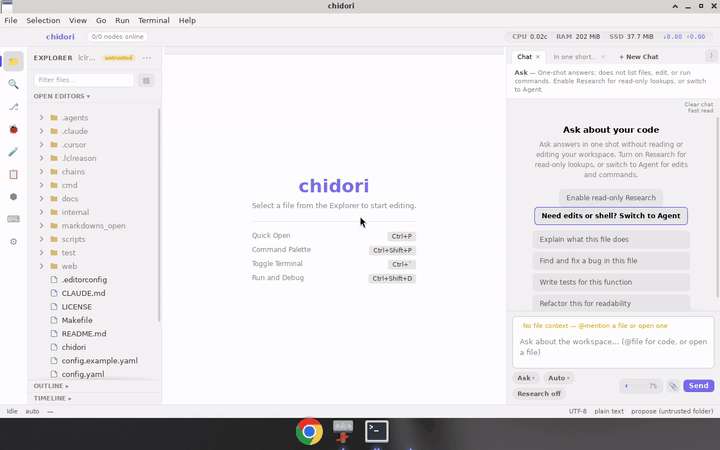
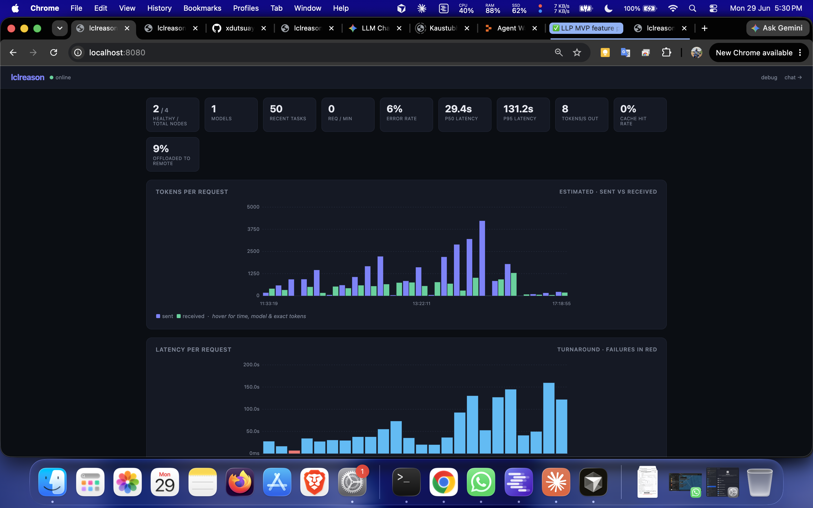
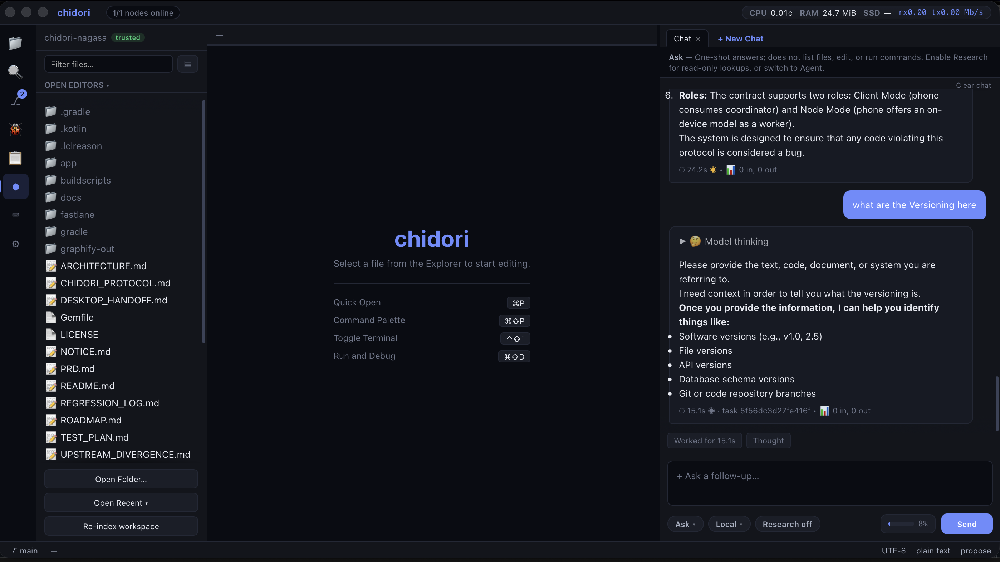
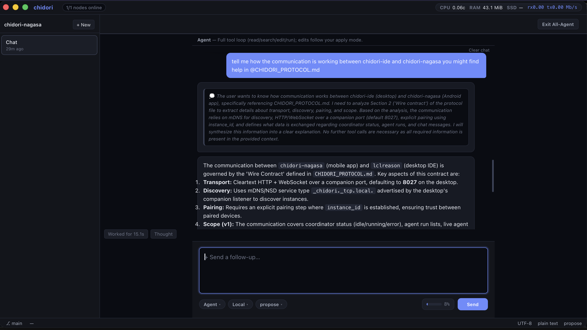
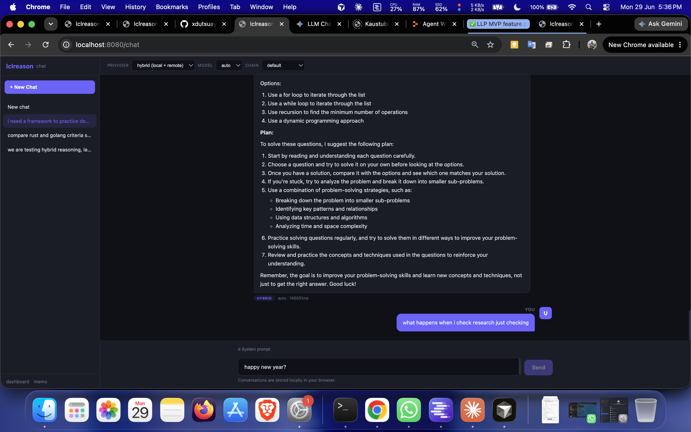
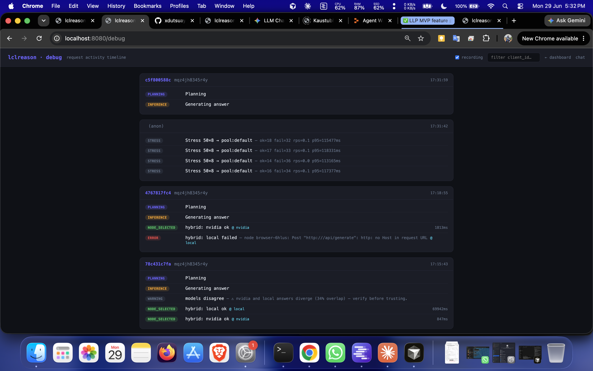
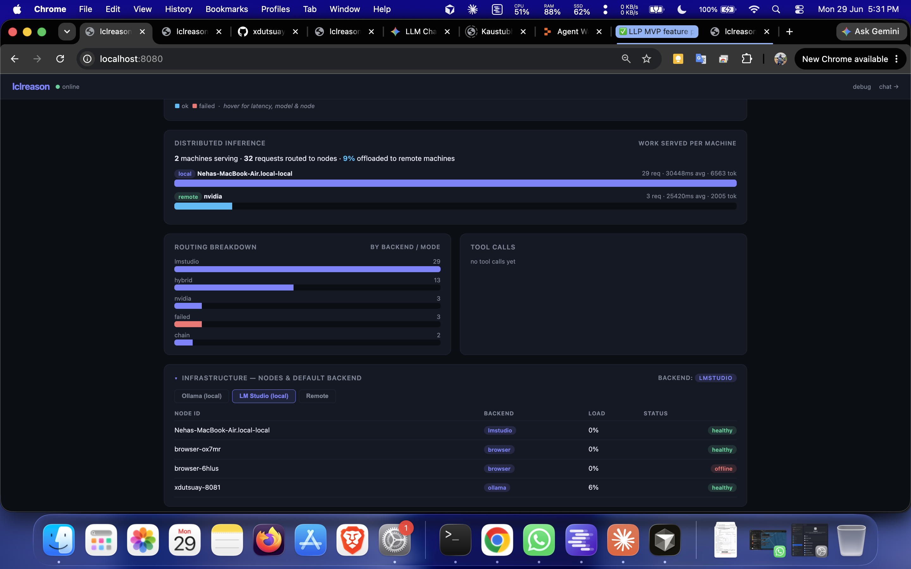

# chidori

<p align="center">
  
  
  
  
</p>

<p align="center">
  <strong>A native desktop IDE with a built-in reasoning engine.</strong><br/>
  Ask · Agent · Plan · Debug — local-first, hybrid-routed, no Electron.
</p>

<p align="center">
  <a href="https://github.com/xdutsuay/chidori/releases/tag/v0.7.27"><strong>⬇ Download v0.7.27</strong></a>
  &nbsp;·&nbsp;
  <a href="https://kaustubhtripathi.com/public/lab/lclreason/"><strong>Product page</strong></a>
</p>

> **Binaries only for the product.** This repository hosts pre-built downloads, screenshots, and docs.
> Selected packages under `internal/` are **structure stubs** (real filenames / signatures, `panic("fake")` bodies) — not a buildable product tree. Do not expect to clone and ship a working IDE from this repo.

**Latest public binary:** [v0.7.27](https://github.com/xdutsuay/chidori/releases/tag/v0.7.27) (from [lclreason v0.7.27](https://github.com/xdutsuay/lclreason/releases/tag/v0.7.27)).

---

## See it in action

Inline **GIF loops** (GitHub autoplays these). Full-length mp4s are on the [v0.5.0 Release](https://github.com/xdutsuay/chidori/releases/tag/v0.5.0).

<table>
  <tr>
    <td align="center" width="50%">
      <a href="https://github.com/xdutsuay/chidori/releases/download/v0.5.0/ask-demo.mp4">
        
      </a><br/>
      <sub><strong>Ask mode</strong> · GIF loop · <a href="https://github.com/xdutsuay/chidori/releases/download/v0.5.0/ask-demo.mp4">full ~3:54 mp4</a></sub>
    </td>
    <td align="center" width="50%">
      <a href="https://github.com/xdutsuay/chidori/releases/download/v0.5.0/ui-highlight.mp4">
        
      </a><br/>
      <sub><strong>UI highlight</strong> · GIF loop · <a href="https://github.com/xdutsuay/chidori/releases/download/v0.5.0/ui-highlight.mp4">full 90s mp4</a></sub>
    </td>
  </tr>
  <tr>
    <td align="center" colspan="2">
      <a href="https://github.com/xdutsuay/chidori/releases/download/v0.5.0/linux-pass.mp4">
        
      </a><br/>
      <sub><strong>Linux pass</strong> (optional) · GIF loop · <a href="https://github.com/xdutsuay/chidori/releases/download/v0.5.0/linux-pass.mp4">full ~59s mp4</a> · not a public Linux zip claim</sub>
    </td>
  </tr>
</table>

More detail: [docs/DEMO.md](docs/DEMO.md).

> Public desktop packages: **macOS arm64**, **Windows x64**, and **Linux x64** (webkit2gtk 4.1).
> Demo mp4s below still live on the [v0.5.0](https://github.com/xdutsuay/chidori/releases/tag/v0.5.0) release assets.

---

## Built for how you work

| Ask | Agent | Plan | Debug |
|:---:|:-----:|:----:|:-----:|
| Direct Q&A with codebase context | Autonomous coding with tool loop & diffs | Architecture & investigation — proposes, doesn't auto-apply | Error diagnosis (pairs with Delve DAP for Go) |

All four share one inference coordinator and **local ↔ hybrid ↔ remote** routing.

---

## Screenshots

Real stills from a live session — also on the [product page](https://kaustubhtripathi.com/public/lab/lclreason/).

<table>
  <tr>
    <td align="center" width="33%">
      <br/>
      <sub>IDE overview</sub>
    </td>
    <td align="center" width="33%">
      <br/>
      <sub>Ask — thinking + task ID</sub>
    </td>
    <td align="center" width="33%">
      <br/>
      <sub>Agent / All-Agent layout</sub>
    </td>
  </tr>
  <tr>
    <td align="center" width="33%">
      <br/>
      <sub>Chat streaming</sub>
    </td>
    <td align="center" width="33%">
      <br/>
      <sub>Debug mode</sub>
    </td>
    <td align="center" width="33%">
      <br/>
      <sub>Distributed inference</sub>
    </td>
  </tr>
</table>

---

## Download v0.7.27

Pre-built binaries from [**Releases**](https://github.com/xdutsuay/chidori/releases) (built from [lclreason `v0.7.27`](https://github.com/xdutsuay/lclreason/releases/tag/v0.7.27)):

| Platform | Artifact |
|:---------|:---------|
| **macOS** (Apple Silicon) | [`chidori-macos-arm64-v0.7.27.zip`](https://github.com/xdutsuay/chidori/releases/download/v0.7.27/chidori-macos-arm64-v0.7.27.zip) |
| **Windows** (x64) | [`chidori-windows-amd64-v0.7.27.zip`](https://github.com/xdutsuay/chidori/releases/download/v0.7.27/chidori-windows-amd64-v0.7.27.zip) |
| **Linux** (x64) | [`chidori-linux-amd64-v0.7.27.zip`](https://github.com/xdutsuay/chidori/releases/download/v0.7.27/chidori-linux-amd64-v0.7.27.zip) |
| **Android companion** | APK from [`xdutsuay/chidori-nagasa`](https://github.com/xdutsuay/chidori-nagasa/releases) |

```bash
# macOS
curl -LO https://github.com/xdutsuay/chidori/releases/download/v0.7.27/chidori-macos-arm64-v0.7.27.zip
unzip chidori-macos-arm64-v0.7.27.zip

# Windows (PowerShell)
curl.exe -LO https://github.com/xdutsuay/chidori/releases/download/v0.7.27/chidori-windows-amd64-v0.7.27.zip

# Linux
curl -LO https://github.com/xdutsuay/chidori/releases/download/v0.7.27/chidori-linux-amd64-v0.7.27.zip
```

> **macOS Gatekeeper.** chidori is **not code-signed or notarized** in v0.7.27.
> On first launch, right-click `chidori.app` → **Open** → confirm **Open**.
> That is Gatekeeper's normal response to unsigned apps — not a malware scan.
> Signing / notarization remain on the public roadmap (KMA-13).

**Requirements:** macOS 10.10+ (Apple Silicon) · Windows 7+ x64 · Linux x64 with webkit2gtk 4.1 · optional [Ollama](https://ollama.com) / [LM Studio](https://lmstudio.ai) for local inference.

---

## What's new in v0.7.27

Fleet slice since v0.7.0 — details on the [product changelog](https://kaustubhtripathi.com/public/lab/lclreason/changelog/):

- **Run board** — lifecycle (`needs_you`) + PR axis (`gh` poller) + Diagnostics board
- **Companion** — phone approve/reject, notifications, `workflow_run_id` for gates
- **Agent** — reflection, goals, job priority, explore notes, A2A handoff, bg-shell session bind
- **Release provenance** — `SHA256SUMS` + `release-manifest.json` on every tag (KMA-66)
- **Hidden Cursor SDK override** + native-vs-SDK tally (compile-time / Diagnostics)

| Status | Item |
|:-------|:-----|
| Shipped | macOS / Windows / Linux desktop zips + checksums |
| Shipped | Android companion (LAN) |
| Later | Signed / notarized macOS builds (KMA-13) |

---

## Hybrid routing

Most AI coding tools force a choice: fully local or fully cloud. chidori treats
*where a request runs* as a routing decision.

```
chidori (native desktop IDE)
  │
  ├── Monaco editor  ──┬── gopls (Go intelligence)
  │                    └── Integrated terminal
  │
  └── Agent chat  ──►  Tool-calling agent loop
                          │
                          ▼
                       Dispatch
                    local ↔ hybrid ↔ remote
                    ┌─────┴─────┐
              Local nodes    Hosted providers
           Ollama / LM Studio   Anthropic / OpenAI /
           / AirLLM (LAN)       Groq / NIM / OpenRouter / …
```

- **Local** — this machine or a LAN node
- **Hybrid** — race local vs hosted; keep the first answer
- **Remote** — hosted key with zero local nodes

Configure in **Settings → Inference Source**.

---

## Companion

Pair an Android phone as companion or optional inference node.

| | |
|:--|:--|
| **APK** | Debug-signed sideload from [`chidori-nagasa` Releases](https://github.com/xdutsuay/chidori-nagasa/releases) (source public / MIT) |
| **Desktop** | Settings → Companion — listen on port **8027** |
| **Phone** | Settings → Chidori Desktop — mDNS discover or `host:8027` |
| **Capabilities** | Monitor runs · remote chat through desktop models · optional phone-as-node (on-device GGUF) |

---

## Getting started

1. **Download** [v0.7.27](https://github.com/xdutsuay/chidori/releases/tag/v0.7.27) for your platform.
2. **Launch** chidori → **File → Open Folder…** and pick a workspace.
3. **Configure inference** in **Settings → Inference Source** — attach Ollama/LM Studio (Scan LAN or IP), or add a hosted OpenAI-compatible API key.
4. **Start chatting** — pick Ask, Agent, Plan, or Debug. Use `@file`, `@folder`, or `@codebase` for workspace context.

<details>
<summary><strong>Optional: Go language features</strong></summary>

```bash
go install golang.org/x/tools/gopls@latest
```

Restart chidori. Go gets diagnostics, go-to-definition, rename, and quick fixes via gopls.
Other languages use Monaco's built-in editing.

</details>

<details>
<summary><strong>Optional: project rules & skills</strong></summary>

- Drop `.lclreason/rules.md` or `.cursorrules` in the project root — injected into every agent request.
- Define slash commands in **Settings → Commands**.
- After a useful run, **Save as Skill** to keep a per-workspace prompt template.

</details>

---

## Deep features

The README stays light. Full product inventory — editor, agent loop, LSP, workflows,
settings, packaging, and explicit non-goals — lives in **[docs/FEATURES.md](docs/FEATURES.md)**.

---

## Feedback

Bugs & ideas → [github.com/xdutsuay/chidori/issues](https://github.com/xdutsuay/chidori/issues)

Product site & changelog → [kaustubhtripathi.com/public/lab/lclreason/](https://kaustubhtripathi.com/public/lab/lclreason/)

Watch [Releases](https://github.com/xdutsuay/chidori/releases) for new binaries.

---

## License

Documentation in this repository is MIT-licensed (see [LICENSE](LICENSE)).

chidori is distributed as **pre-built binaries only**. **Source code is not published.**
